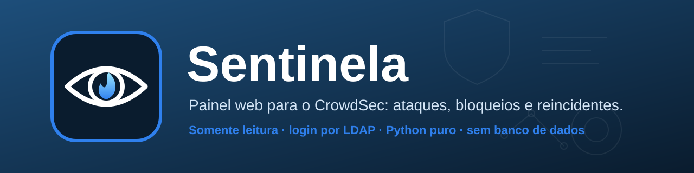
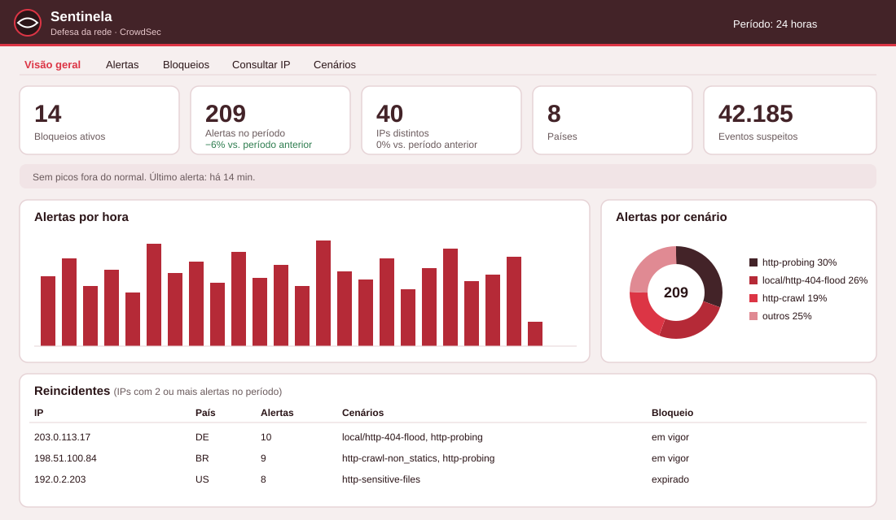
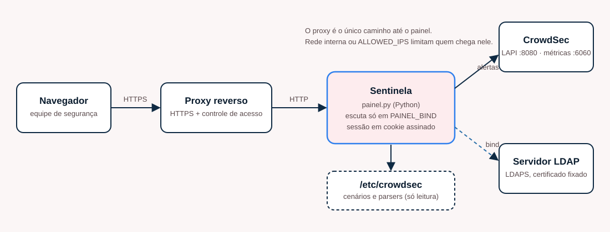

<p align="center">
  
</p>

<p align="center">
  
  
  
  
</p>

**Sentinela** é um painel web para o [CrowdSec](https://www.crowdsec.net): mostra **quem está atacando os seus sites, o que cada IP tentou fazer, o que já foi bloqueado e quem insiste em voltar**, em português e sem precisar de terminal. É um único processo Python (biblioteca padrão; o `ldap3` só serve ao login), não tem banco de dados e, com uma exceção controlada (liberar um IP bloqueado), **só lê** o CrowdSec.

Foi feito para equipes que rodam o CrowdSec na frente de um proxy reverso (Nginx Proxy Manager, Nginx, Traefik...) e querem que mais gente da equipe enxergue os ataques sem dar acesso ao servidor.

<p align="center">
  
</p>

---

## Sumário

1. [Por que existe](#por-que-existe)
2. [O que mostra e o que não faz](#o-que-mostra-e-o-que-não-faz)
3. [Arquitetura](#arquitetura)
4. [Requisitos](#requisitos)
5. [Instalação](#instalação)
6. [Publicar atrás do proxy reverso](#publicar-atrás-do-proxy-reverso)
7. [Configuração](#configuração)
8. [Autenticação](#autenticação)
9. [Uso](#uso)
10. [Segurança](#segurança)
11. [Desenvolvimento e testes](#desenvolvimento-e-testes)
12. [Limites conhecidos](#limites-conhecidos)
13. [FAQ](#faq)
14. [Licença](#licença)

---

## Por que existe

O `cscli` mostra tudo o que o CrowdSec sabe, mas só para quem tem acesso ao servidor e conhece os comandos. Na prática, quem precisa responder "esse IP é nosso?", "estão atacando o sistema X?" ou "por que bloquearam o fulano?" não tem esse acesso. O Sentinela leva essas respostas para uma tela, com login pelo diretório da organização, e deixa um grupo pequeno liberar um IP bloqueado por engano, com registro de quem liberou e por quê.

## O que mostra e o que não faz

**Mostra**

- **Visão geral:** bloqueios ativos, alertas, IPs e eventos do período, cada um comparado ao período anterior; faixa de **pico** quando há um salto fora do normal; alertas por hora ou dia; proporção por cenário; países, IPs e redes (AS) mais ativos; **sites mais atacados**; **funil** (alerta → IP → bloqueio → reincidente); **reincidentes**; mapa de calor por dia da semana e hora.
- **Alertas** e **Bloqueios:** listas filtráveis, ordenáveis e exportáveis em CSV. Cada alerta abre com os pedidos que o IP fez (método, caminho, status, site, *user-agent*) e o JSON bruto.
- **Consultar IP:** histórico completo de um endereço: alertas, cenários acionados, **linha do tempo por dia**, sites atingidos e decisões em vigor, inclusive as da lista da comunidade.
- **Cenários:** o que cada regra de detecção faz, quanto disparou e se está instalada.
- **Saúde do CrowdSec:** versão, fontes de log lidas (e quantas linhas o CrowdSec não conseguiu interpretar), buckets, decisões e *heartbeat* das máquinas.
- **Configuração:** fontes de aquisição, coleções, cenários e parsers instalados (só leitura).
- Explicações em português ao passar o mouse sobre cenários, ações e origens (`static/glossario.js`, fácil de ampliar).

**Faz uma única escrita:** *liberar IP*. Exige estar na lista `UNBAN_USERS`, a senha de liberação, um motivo e um IP válido; tem limite de tentativas e deixa registro.

**Não faz:** não detecta nada por conta própria (quem detecta é o CrowdSec), não bloqueia, não substitui o `cscli` para administrar e não guarda dados: tudo vem da API local do CrowdSec na hora.

## Arquitetura

<p align="center">
  
</p>

O Sentinela roda **no mesmo host do CrowdSec**. Fala com a API local (`127.0.0.1:8080`) usando uma máquina própria, lê as métricas Prometheus (`127.0.0.1:6060`) e os arquivos de `/etc/crowdsec` em modo leitura, e escuta só no IP interno que você escolher. Quem o publica, com HTTPS, é o seu proxy reverso.

## Requisitos

- Linux com **systemd**, **CrowdSec** (desenvolvido e testado no 1.8) com a API local ativa, e `cscli` no host.
- **Python 3.10+** (`python3`), `openssl` e `curl`.
- Um **servidor LDAP/LDAPS** para o login (OpenLDAP, FreeIPA, 389-ds, Active Directory...), com o atributo `memberOf` se quiser acesso por grupo.
- Um proxy reverso com HTTPS na frente do painel.
- `ldap3` (o instalador cuida: `apt install python3-ldap3` ou `pip --target`).

## Instalação

> Rode no host onde o CrowdSec está. Os comandos usam dados fictícios: troque pelos seus.

```bash
git clone <url-do-repositorio> sentinela && cd sentinela
sudo ./deploy/instalar.sh
```

O instalador cria o usuário de serviço `sentinela`, copia o programa para `/opt/sentinela`, gera o `PAINEL_SECRET`, cria no CrowdSec a **máquina** `sentinela` e o **bouncer** `sentinela-web` (para consultar decisões por IP), instala a *unit* do systemd e **para antes de iniciar**, porque o login precisa da sua configuração:

1. Edite `/opt/sentinela/.env`: a seção **Autenticação** (`LDAP_*`) e **Quem entra** (`ALLOWED_GROUP`). Os valores de exemplo (`ldap.exemplo.com`) precisam ser trocados.
2. Coloque o certificado do LDAP em `LDAP_CA` ([como obter](docs/AUTENTICACAO.md#obter-o-certificado-do-ldap)).
3. Inicie:

```bash
sudo systemctl restart sentinela
sudo systemctl status sentinela --no-pager
curl -s http://127.0.0.1:8088/sentinela/saude        # deve responder {"ok":true}
```

Para atualizar: `git pull && sudo ./deploy/instalar.sh` (preserva o `.env` e acrescenta chaves novas).

**Teste rápido sem CrowdSec nem LDAP** (dados fictícios): veja o modo demonstração em [CONTRIBUTING.md](CONTRIBUTING.md).

### Liberação de IPs (opcional)

```bash
# 1) em /opt/sentinela/.env: UNBAN_USERS=ana.silva,carlos.souza
# 2) defina a senha de liberação (digitada sem eco; só o hash vai para o .env):
sudo ./deploy/senha-liberacao.sh
```

Sem `UNBAN_HASH` a função fica desligada e o painel é 100% leitura.

### Exemplos para o CrowdSec

A pasta [`contrib/crowdsec`](contrib/crowdsec) traz exemplos prontos: leitura dos logs do Nginx Proxy Manager, uma lista de IPs que nunca devem ser banidos e o cenário `local/http-404-flood` (muitos 404 do mesmo IP). Nada é instalado por você sem querer: copie o que quiser para `/etc/crowdsec/`.

## Publicar atrás do proxy reverso

O painel fala HTTP simples e escuta só em `PAINEL_BIND`. Quem faz HTTPS é o proxy.

- **Proxy no mesmo host, fora do Docker:** `PAINEL_BIND=127.0.0.1` e o proxy aponta para `http://127.0.0.1:8088`.
- **Proxy em contêiner Docker (ex.: Nginx Proxy Manager):** use `PAINEL_BIND=172.17.0.1` (IP do `docker0`) e aponte o *Proxy Host* para `http://172.17.0.1:8088`. Assim o contêiner alcança o painel e a rede local não.
- **Subcaminho:** `PAINEL_BASE=/sentinela` publica em `https://seu-dominio/sentinela/`. O painel funciona com o proxy removendo ou não o prefixo. Para publicar na raiz de um domínio próprio, deixe `PAINEL_BASE=` vazio.
- Mantenha `COOKIE_SECURE=1` (o cookie só trafega por HTTPS) e ajuste `TRUSTED_PROXIES` para a rede de onde o proxy chega ao painel: só dela o painel aceita o IP do cliente enviado em `X-Forwarded-For`.
- Se puder, limite por rede no próprio proxy (lista de acesso) ou com `ALLOWED_IPS`.

## Configuração

Tudo por variáveis de ambiente, no `.env` (modelo completo e comentado em [`.env.example`](.env.example)).

| Variável | Padrão | Para que serve |
|---|---|---|
| `ORG_NOME` | vazio | Nome da organização no título e no login |
| `PAINEL_TZ` | `America/Sao_Paulo` | Fuso de exibição (nome IANA) |
| `PAINEL_BIND` / `PAINEL_PORT` | `127.0.0.1` / `8088` | Onde o painel escuta |
| `PAINEL_BASE` | vazio | Subcaminho publicado no proxy (ex.: `/sentinela`) |
| `PAINEL_SECRET` | gerado | Assina o cookie de sessão (mínimo 32 caracteres) |
| `COOKIE_SECURE` | `1` | Cookie só por HTTPS |
| `IDLE_SECONDS` / `MAX_LIFE_SECONDS` | `900` / `28800` | Inatividade e vida máxima da sessão |
| `REMEMBER_DAYS` | `7` | "Lembrar de mim" (0 desliga) |
| `TRUSTED_PROXIES` | `172.16.0.0/12` | Redes de onde se aceita `X-Forwarded-For` |
| `LAPI_URL` / `LAPI_MACHINE` / `LAPI_PASSWORD` | local / `sentinela` / gerado | API local do CrowdSec |
| `BOUNCER_KEY` | gerado | Consulta de decisões por IP (opcional) |
| `PROM_URL` | `http://127.0.0.1:6060/metrics` | Métricas do CrowdSec |
| `CROWDSEC_CONFIG_DIR` | `/etc/crowdsec` | Onde ler cenários e parsers |
| `LDAP_HOST` / `LDAP_PORT` | **obrigatório** / `636` | Servidor LDAPS |
| `LDAP_BASE` | **obrigatório** | Base de busca dos usuários |
| `LDAP_USER_DN` | `uid={usuario},{base}` | Molde do DN usado no bind |
| `LDAP_CA` / `LDAP_NAME` | **obrigatório** | Certificado fixado e nome DNS que consta nele |
| `ALLOWED_GROUP` | vazio | DN do grupo que pode entrar |
| `ALLOWED_USERS` | vazio | Logins avulsos que também entram |
| `ALLOWED_IPS` | vazio | Limita por IP/rede de quem abre o painel |
| `UNBAN_USERS` / `UNBAN_HASH` | vazio | Quem pode liberar IPs e o hash da senha de liberação |

Sem `LDAP_*` completo, o serviço **não inicia** e diz o que falta.

## Autenticação

Login por *bind* LDAPS com certificado fixado, sem guardar senha. Entra quem estiver em `ALLOWED_GROUP` (via `memberOf`), em `ALLOWED_USERS` ou em `UNBAN_USERS`. Detalhes, exemplos de `LDAP_USER_DN` (OpenLDAP, FreeIPA, AD), como obter o certificado e como usar dois servidores: [docs/AUTENTICACAO.md](docs/AUTENTICACAO.md).

## Uso

- **Período:** seletor no topo (1 h, 24 h, 7 d, 30 d). A tela atualiza a cada 30 s.
- **Passe o mouse (ou toque) em um cenário, ação ou IP** para ver a explicação e, nos alertas, o que o IP tentou fazer.
- **Clique em um alerta** para abrir os eventos; de lá, "Histórico do IP" leva à consulta completa.
- **Liberar IP:** na aba *Bloqueios* ou na consulta de um IP (só aparece para quem está em `UNBAN_USERS` e com a função ligada). Exige a senha de liberação e um motivo. O histórico fica na aba *Bloqueios*.
- Todos os horários usam o fuso de `PAINEL_TZ`.

## Segurança

- Somente leitura, exceto a liberação de IP (login + permissão + senha + motivo + limite de tentativas + registro).
- Texto que vem da rede (caminhos, *user-agent*, hosts) entra na tela por `textContent`, nunca por `innerHTML`; a política de conteúdo (CSP) só permite scripts do próprio painel.
- Cookie `HttpOnly`, `SameSite=Strict`, `Secure`, assinado, sem estado no servidor.
- Serviço systemd endurecido (`NoNewPrivileges`, `ProtectSystem=strict`, `PrivateTmp`, sem *capabilities*, usuário sem login).
- Nenhuma senha em log ou em disco; a senha de liberação existe só como hash PBKDF2.

Leia [SECURITY.md](SECURITY.md) para relatar falhas e para as boas práticas de quem instala.

## Desenvolvimento e testes

```bash
pip install -r requirements.txt            # só o ldap3
python -m unittest -v                      # nenhum teste usa rede, CrowdSec ou LDAP
for f in static/*.js; do node --check "$f"; done
```

Os testes usam amostras **fictícias** em `tests_data/` (métricas e configuração do CrowdSec) e simulam o LDAP. Veja [CONTRIBUTING.md](CONTRIBUTING.md).

## Limites conhecidos

- O instalador **ainda não foi testado em um servidor limpo**; o painel nasceu em produção, mas o caminho de instalação deste repositório é novo. Relate o que encontrar.
- "Sites mais atacados" lê o nome do site dos **eventos** dos alertas. Se a API do seu CrowdSec não devolver os eventos na lista, o cartão avisa em vez de mostrar números.
- A busca de usuários usa o atributo `uid`; em um Active Directory sem `uid`, use `ALLOWED_USERS` ou abra uma *issue*.
- Pensado para um proxy reverso na frente de sites web. Outras fontes de log do CrowdSec aparecem, mas a tela é voltada a alertas HTTP.
- Interface apenas em português do Brasil.

## FAQ

**Preciso do Nginx Proxy Manager?** Não. Qualquer coisa que o CrowdSec leia serve; o painel só consome a API do CrowdSec. O NPM é o caso de uso original.

**Funciona com o CrowdSec em Docker?** A API e as métricas precisam estar acessíveis em `LAPI_URL` e `PROM_URL`, e `/etc/crowdsec` em `CROWDSEC_CONFIG_DIR` (ou as abas de cenários ficam sem descrição). O instalador assume CrowdSec instalado no host.

**Posso rodar sem LDAP?** Não: o login é só por LDAP, de propósito (sem banco de senhas para cuidar). Se você precisa de outro método, abra uma *issue*.

**Um IP meu foi banido. E agora?** Consulte-o na aba *Consultar IP* para ver qual cenário o acionou. Se o painel permitir, libere com um motivo; se for recorrente (rede do escritório), coloque-o na *whitelist* ([exemplo](contrib/crowdsec/parsers/s02-enrich/local-whitelist.yaml)).

## Licença

[MIT](LICENSE).
